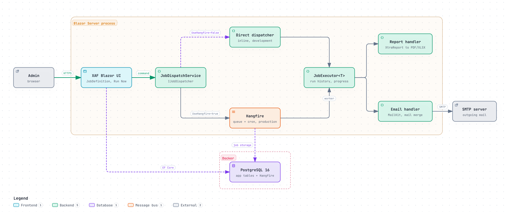

# xafhangfire

DevExpress XAF application with a pluggable job dispatcher architecture for background task execution via Hangfire.

<picture>
  <source media="(prefers-color-scheme: dark)" srcset="docs/images/architecture-dark.png">
  
</picture>

<sub>Diagram source: <code>docs/images/architecture.archify.json</code> (rendered with Archify).</sub>

## Overview

This project demonstrates a **Command/Handler + Pluggable Dispatcher** pattern that separates job business logic from execution strategy. Jobs can run inline (for local development/debugging) or be queued through Hangfire (for production), toggled by configuration.

### Key Features

- **Pluggable job dispatch** — switch between inline and Hangfire execution via config
- **Report generation** — DevExpress XtraReport export to PDF/XLSX with parameterized reports
- **Email jobs** — MailKit SMTP with templates, mail merge, and report-as-attachment
- **Job execution history** — every run tracked with status, duration, and error details
- **Job progress reporting** — opt-in progress updates (percent + message) for long-running handlers
- **Failure tracking** — consecutive failure counter with configurable alert threshold
- **Hangfire dashboard** — role-based access control (Administrators only in production)
- **Cron visualization** — human-readable cron descriptions + next 5 scheduled run times
- **Job calendar** — read-only scheduler view of upcoming runs of every enabled job (Blazor, Jobs → Job Calendar)
- **Rich parameter UI** — dynamic typed form fields from command record reflection (replaces raw JSON)
- **Admin UI** — XAF auto-generated CRUD views for JobDefinitions, templates, CRM entities
- **Background auth** — HangfireJob service user for secured object space access

## Architecture

```
xafhangfire.Jobs              xafhangfire.Module             xafhangfire.Blazor.Server
  IJobHandler<T>                JobDefinition                  Startup (DI + Hangfire)
  IJobDispatcher                JobExecutionRecord             XafJobScopeInitializer
  DirectJobDispatcher           EmailTemplate                  XafJobExecutionRecorder
  HangfireJobDispatcher         Organization/Contact/etc       GenerateReportHandler
  JobExecutor<T>                XtraReport classes             SendReportEmailHandler
  JobDispatchService                                           SmtpEmailSender
  DateRangeResolver                                            JobSyncService
  IJobScopeInitializer                                         HangfireDashboardAuthFilter
  IJobExecutionRecorder
```

**Flow:** `JobDefinition (XAF UI)` → `RunNow action` → `JobDispatchService` → `IJobDispatcher` → `JobExecutor<T>` → `IJobHandler<T>`

## Projects

| Project | Description |
|---------|-------------|
| `xafhangfire.Module` | Shared business logic, EF Core entities, XAF module config, XtraReport classes |
| `xafhangfire.Blazor.Server` | Blazor Server web UI + Web API + Hangfire dashboard + handler implementations |
| `xafhangfire.Win` | WinForms desktop UI |
| `xafhangfire.Jobs` | Job dispatcher abstractions, command records, handlers, shared interfaces |

## Tech Stack

- **.NET 10**, **DevExpress XAF 26.1**, **EF Core 10**
- **PostgreSQL 16** via Docker (app DB + Hangfire storage)
- **Hangfire** with PostgreSQL storage (in-memory fallback)
- **MailKit** for SMTP email
- **Serilog** for structured logging
- **Blazor Server** + **SignalR** for web UI
- **Swagger/OpenAPI** at `/swagger` (dev only)

## Prerequisites

- .NET 10 SDK
- Docker (for PostgreSQL)
- DevExpress 26.1 NuGet feed configured

## Getting Started

```bash
# 1. Start PostgreSQL
docker compose up -d

# 2. Build
dotnet build xafhangfire.slnx

# 3. Update database schema
dotnet run --project xafhangfire/xafhangfire.Blazor.Server/xafhangfire.Blazor.Server.csproj -- --updateDatabase --forceUpdate --silent

# 4. Run tests
dotnet test xafhangfire/xafhangfire.Jobs.Tests/xafhangfire.Jobs.Tests.csproj

# 5. Run Blazor Server (https://localhost:5001)
dotnet run --project xafhangfire/xafhangfire.Blazor.Server/xafhangfire.Blazor.Server.csproj
```

Default dev users: `Admin` and `User` (empty passwords).

### Endpoints

| URL | Description |
|-----|-------------|
| `https://localhost:5001` | Blazor Server UI |
| `https://localhost:5001/hangfire` | Hangfire dashboard (requires login) |
| `https://localhost:5001/swagger` | Swagger UI (dev only) |
| `https://localhost:5001/api/odata` | OData v4.01 API |
| `https://localhost:5001/api/jobs/*` | Job test endpoints |

## Job Dispatcher

Toggle between direct (inline) and Hangfire execution:

```json
{ "Jobs": { "UseHangfire": false } }   // local dev — breakpoints work
{ "Jobs": { "UseHangfire": true } }    // production — async via Hangfire
```

With Hangfire on PostgreSQL, jobs that were running when the app crashed or was killed are picked up again after
5 minutes (sliding invisibility timeout); a graceful stop requeues them right away.

### Built-in Job Types

| Command | Handler | Description |
|---------|---------|-------------|
| `DemoLogCommand` | `DemoLogHandler` | Logs a message with optional delay |
| `ListUsersCommand` | `ListUsersHandler` | Lists application users |
| `GenerateReportCommand` | `GenerateReportHandler` | Exports XtraReport to PDF/XLSX |
| `SendEmailCommand` | `SendEmailHandler` | Sends a single email |
| `SendReportEmailCommand` | `SendReportEmailHandler` | Generates report and emails as attachment |
| `SendMailMergeCommand` | `SendMailMergeHandler` | Template-based bulk email to CRM contacts |

### Report Parameters

Reports accept parameters via `ReportParameters` dictionary in the command JSON:

```json
{
  "ReportName": "Project Status Report",
  "OutputFormat": "Pdf",
  "ReportParameters": {
    "StartDate": "last-month",
    "EndDate": "this-month"
  }
}
```

Date parameters support friendly terms via `DateRangeResolver`: `today`, `yesterday`, `this-week`, `last-week`, `this-month`, `last-month`, `this-quarter`, `last-quarter`, `this-year`, `last-year`.

### Job Progress Reporting

Handlers can opt into progress reporting by accepting `IJobProgressReporter` via constructor injection:

```csharp
public sealed class MyHandler(
    ILogger<MyHandler> logger,
    IJobProgressReporter progressReporter) : IJobHandler<MyCommand>
{
    public async Task ExecuteAsync(MyCommand command, CancellationToken cancellationToken)
    {
        for (var i = 0; i < totalSteps; i++)
        {
            var percent = (int)((double)(i + 1) / totalSteps * 100);
            await progressReporter.ReportAsync(percent, $"Step {i + 1}/{totalSteps}", cancellationToken);
            // ... do work ...
        }
    }
}
```

Progress updates (`ProgressPercent` and `ProgressMessage`) are written to the `JobExecutionRecord` in real time.

### Consecutive Failure Tracking

`JobDefinition.ConsecutiveFailures` tracks how many times a job has failed in a row. The counter resets to 0 on success and increments on failure. When failures reach the configured threshold (`Jobs:FailureAlertThreshold`, default: 3), a warning is logged.

## Configuration

### appsettings.json

```json
{
  "ConnectionStrings": {
    "ConnectionString": "EFCoreProvider=PostgreSql; Host=localhost;Port=5433;Database=xafhangfire;Username=xafhangfire;Password=xafhangfire"
  },
  "Jobs": {
    "UseHangfire": true,
    "FailureAlertThreshold": 3
  },
  "Email": {
    "Smtp": {
      "Host": "",
      "Port": 587,
      "Username": "",
      "Password": "",
      "FromAddress": "noreply@example.com",
      "FromName": "XAF Hangfire"
    }
  },
  "Reports": {
    "OutputDirectory": "reports"
  }
}
```

- **Email**: Leave `Host` empty for log-only mode (dev). Set SMTP host for real delivery.
- **Reports**: Output directory for generated reports (relative to app root or absolute path). Use forward slashes for Windows paths in JSON (e.g., `c:/projects/xafhangfire/reports`).

## Adding a New Job

1. Create a command record in `Jobs/Commands/`:
   ```csharp
   public record MyCommand(string Param1, int Param2 = 10);
   ```

2. Create a handler implementing `IJobHandler<MyCommand>`:
   ```csharp
   public sealed class MyHandler(ILogger<MyHandler> logger) : IJobHandler<MyCommand>
   {
       public async Task ExecuteAsync(MyCommand command, CancellationToken cancellationToken = default)
       {
           logger.LogInformation("Running with {Param1}", command.Param1);
       }
   }
   ```

3. Register in `Startup.cs`:
   ```csharp
   services.AddJobHandler<MyCommand, MyHandler>();
   ```

4. Add a case in `JobDispatchService.cs` for string-based dispatch from the admin UI.

5. Optionally seed a `JobDefinition` in `Updater.cs` for the admin UI.

See [docs/integration-guide.md](docs/integration-guide.md) for integrating this pattern into your own XAF solution.

## Design Documents

| Document | Description |
|----------|-------------|
| [job-dispatcher-architecture.md](job-dispatcher-architecture.md) | Original architecture reference |
| [docs/plans/2026-02-18-job-dispatcher-design.md](docs/plans/2026-02-18-job-dispatcher-design.md) | Job dispatcher implementation design |
| [docs/plans/2026-02-19-email-jobs-design.md](docs/plans/2026-02-19-email-jobs-design.md) | Email jobs design |
| [docs/plans/2026-02-21-postgresql-migration-design.md](docs/plans/2026-02-21-postgresql-migration-design.md) | PostgreSQL migration design |
| [docs/plans/2026-02-21-hangfire-auth-fix-design.md](docs/plans/2026-02-21-hangfire-auth-fix-design.md) | Background job auth fix |
| [docs/plans/2026-02-21-progress-and-error-notifications-design.md](docs/plans/2026-02-21-progress-and-error-notifications-design.md) | Progress reporting + failure tracking |
| [docs/plans/2026-02-21-cron-and-parameter-ui-design.md](docs/plans/2026-02-21-cron-and-parameter-ui-design.md) | Cron visualization + rich parameter UI |

## Status

Open work is tracked on ContextBoard (project `xafhangfire`). Project history, architecture decisions and gotchas: [docs/project-history.md](docs/project-history.md).
